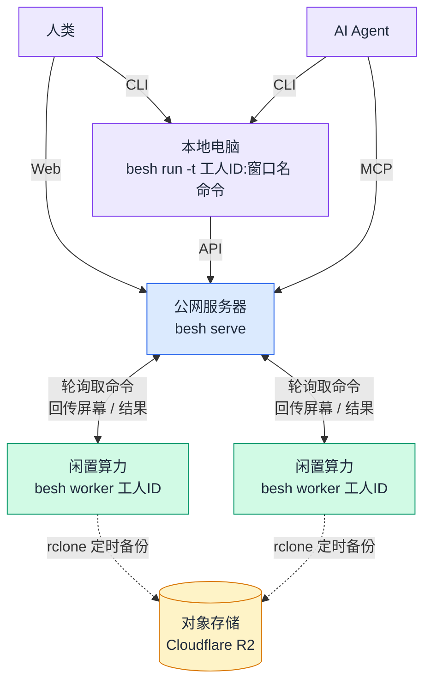

# Beacon Shell (besh)

**把闲置算力变成 AI Agent 可远程操作的工人。**

闲置算力随处可见：手机 Termux、免费的云 IDE、云 Notebook……但它们大多没有公网 IP，没法通过 SSH 远程操作。

besh 用一个"信标 + 工人"的架构解决这个问题：只要闲置终端能访问外网，就能反向连接信标、领取命令、回传结果——你（或你的 AI Agent）则可以像操作 tmux 一样操作散落在各处的机器。



## 四个角色

| 角色 | 运行位置 | 职责 |
|------|----------|------|
| 信标 | 有公网 IP 的服务器 | 中转命令、记录状态、提供 Web 界面与 MCP 接口 |
| 工人 | 任意闲置终端（无公网 IP） | 轮询信标领命令，在 tmux 窗口里执行，定时备份工作目录 |
| 遥控器 | 本地电脑 | 类似 tmux 的命令行，把 session 换成工人 ID，可同时操作多台 |
| 对象存储 | Cloudflare R2 | 备份工人工作目录（工人是临时的，随时会释放） |

## 安装

```bash
pip install besh
```

要求 Python ≥ 3.10。工人机器上还需要安装 [tmux](https://github.com/tmux/tmux)。

## 快速开始

### 1. 启动信标（云服务器）

```bash
besh serve   # 首次运行会生成 .env（含自动生成的 besh_secret），也可自己先 export
```

启动时会生成自包含的 `besh_beacon.py`（主程序）和 `www/index.html`（Web 界面）；**运行时状态全在内存，不写任何数据文件**。默认监听 `12242` 端口，输出类似：

```
  工人连接 : export besh_url=http://<HOST>:12242?secret=xxx
  浏览器   : http://<HOST>:12242/?secret=xxx
  MCP      : http://<HOST>:12242/mcp  (Authorization: Bearer xxx)
```

**入口程序就是配置文件**：`besh_beacon.py` 顶部写着监听地址和端口，直接改、重启即生效：

```python
# ============ 配置（直接改这里，改完重启生效） ============
CFG_HOST = "0.0.0.0"   # 监听地址；"0.0.0.0" 表示所有网卡
CFG_PORT = 8080        # 监听端口
# =========================================================
```

也可以用 `besh serve --host --port` 修改，它们会**写进**入口程序（首次生成时烘焙，已存在则原地更新），不用环境变量。改完端口后，工人和遥控器的 `besh_url` 需同步更新。

### 2. 接入工人（闲置终端）

地址直接写在命令行上，不需要环境变量：

```bash
besh worker WORKER_ID http://BEACON-HOST:12242?secret=CHANGE_TO_YOUR_PASSWORD
```

- 会创建 `./WORKER_ID` 作为工作目录，后续所有命令都在这个目录里执行
- 通过 tmux 启动 `besh_worker` 会话（创建窗口、执行命令）和 `besh_sync` 会话（定时把工作目录同步到对象存储）

### 3. 远程操作（本地电脑）

遥控器用全局 `-u` 参数指定信标，或设置 `besh_url` 环境变量（也可写在当前目录 `.env` 里）：

```bash
besh -u http://BEACON-HOST:12242?secret=CHANGE_TO_YOUR_PASSWORD ls
# 或
export besh_url=http://BEACON-HOST:12242?secret=CHANGE_TO_YOUR_PASSWORD

# 列出所有工人（ls / list-sessions / list-workers 等价）
besh ls

# 列出某工人的所有窗口
besh list-windows -t WORKER_ID

# 查看窗口内容（同 tmux capture-pane）
besh capture-pane -t WORKER_ID:WINDOW_NAME -p -S -50

# 发送按键（窗口不存在会自动创建）
besh send-keys -t WORKER_ID:WINDOW_NAME "ls -l" Enter

# 发送按键，-l 按字面处理（不展开变量）
besh send-keys -t WORKER_ID:WINDOW_NAME -l 'echo "Hello $USER"'

# 执行一条命令并打印输出（体验类似 ssh host cmd）
besh run -t WORKER_ID "uname -a"

# 跑长任务：先输入不等待，稍后等它执行完（窗口回到提示符）
besh type -t WORKER_ID:WINDOW_NAME "python train.py"
besh wait -t WORKER_ID:WINDOW_NAME
```

## 对象存储（Cloudflare R2）

信标带宽贵、网速慢，不适合备份工作目录；[Cloudflare R2](https://developers.cloudflare.com/r2/) 免费 10GB 且网速快，所以用它。工人工作目录备份在 `cf:besh/YYYY-MM-DD/WORKER_ID/*`。

1. 开通 Cloudflare R2，创建存储桶 `besh`
2. 在信标与工人机器上安装 [rclone](https://rclone.org/install/)：

   ```bash
   sudo -v ; curl https://rclone.org/install.sh | sudo bash
   ```

3. 配置 rclone 环境变量访问 R2：

   ```bash
   export RCLONE_CONFIG_CF_TYPE=s3
   export RCLONE_CONFIG_CF_PROVIDER=Cloudflare
   export RCLONE_CONFIG_CF_ACCESS_KEY_ID=
   export RCLONE_CONFIG_CF_SECRET_ACCESS_KEY=
   export RCLONE_CONFIG_CF_ENDPOINT=
   export RCLONE_CONFIG_CF_REGION=auto
   ```

配置好后，遥控器即可管理备份：

```bash
besh backup  -t WORKER_ID              # 立刻备份（不等定时任务）
besh restore -t WORKER_ID              # 从最新备份恢复工作目录
besh files  -t WORKER_ID               # 列出对象存储里的备份文件
besh download / besh upload / besh rm  # 下载 / 上传 / 删除文件
```

## Web 操作界面

浏览器打开 `http://BEACON-HOST:12242?secret=xxx`：

- 每个工人的实时状态（主机名、工作目录、窗口列表、在线状态）
- 完善的 WebShell：实时屏幕、输入框、`^C` / `^D` / `Tab` / `↑` / `↓` / `Esc` 按键助手
- 基于对象存储的文件上传 / 下载 / 直链分享

## AI Agent 接入

besh 为 AI Agent 提供两条通道，任选其一：

**MCP**（信标内置）：

```bash
besh mcp          # 打印 MCP 客户端配置
besh mcp --write ~/.workbuddy/mcp.json   # 直接写入客户端配置
```

**CLI 技能**（把 besh 命令教给 Agent）：

```bash
besh skill        # 打印 SKILL.md
besh skill --install ~/.workbuddy/skills/   # 安装为 Agent 技能
```

## 命令一览

| 命令 | 说明 |
|------|------|
| `besh serve` | 在当前目录启动信标 |
| `besh worker ID` | 以工人身份接入信标 |
| `besh ls` | 列出所有工人 |
| `besh list-windows -t ID` | 列出工人的窗口 |
| `besh capture-pane -t ID:WIN` | 查看窗口内容 |
| `besh send-keys -t ID:WIN …` | 向窗口发送按键 |
| `besh type -t ID:WIN TEXT` | 输入文本（可选回车），Agent 友好 |
| `besh run -t ID:WIN CMD` | 执行命令并打印输出 |
| `besh new-window` / `kill-window` | 新建 / 关闭窗口 |
| `besh kill-worker -t ID` | 让工人退出（tmux 会话一并关闭） |
| `besh wait -t ID:WIN` | 等待窗口回到提示符（命令执行完毕） |
| `besh wait CMD_ID` | 等待某条异步命令的回执 |
| `besh history` / `besh info` | 命令历史 / 工人详情 |
| `besh files` / `download` / `upload` / `rm` | 管理对象存储里的文件 |
| `besh backup` / `restore` | 备份 / 恢复工作目录 |
| `besh mcp` / `besh skill` | 生成 MCP / Agent 技能配置 |

环境变量：`besh_url`（信标地址）、`besh_secret`（密钥）。也可以用 `-u` / `--secret` 参数临时指定，或 `--json` 输出 JSON。

`besh serve` 会在信标目录生成 `.env`（只含 `besh_secret`——监听地址/端口属于 `besh_beacon.py`，不放在这里）。信标启动和 CLI 命令都会自动加载当前目录的 `.env`。该文件含密钥，请勿提交到 git。

## 可靠性设计

- **运行时零磁盘写入**：信标的全部状态（工人表、命令队列、屏幕缓存）都在内存里，不建数据库、不写 WAL、不落任何文件。机器人式的刷屏、心跳和历史不会再把服务器磁盘写满；信标进程重启后状态自然清空，工人会自动重连并重新注册。
- **内存有硬上限**：命令记录最多 1000 条（单条输出 ≤64KB，10 分钟后老输出裁到 2KB），屏幕缓存每窗口只留末尾 60 行，工人表最多 200 个，超出即淘汰最旧项。典型 10 个工人总占用只有几 MB，不随运行时间增长。
- **命令不丢（进程内）**：命令在内存队列里排队；投递后 120 秒无回执自动重排（工人可能已重启）。工人侧按命令 ID 去重，最坏情况重复执行一次（at-least-once）。信标进程重启会清空队列，未完成的命令需要客户端重发。
- **屏幕秒回**：工人只把内容变化的窗口推给信标缓存（压缩传输），`capture-pane` 无需等待；空闲时完全不推送，也就没有任何写盘和网络流量。
- **安全模型**：单一密钥认证（信标侧）；工人本身处在容器 / 虚拟机内，不提供额外的安全隔离。

## 开机自启（systemd）

信标不落盘，可以放心交给 systemd 托管，崩溃或重启后自动拉起（工人会自己重连）：

```ini
# /etc/systemd/system/besh-beacon.service
[Unit]
Description=besh beacon
After=network-online.target
Wants=network-online.target

[Service]
Type=simple
WorkingDirectory=/opt/besh-beacon
EnvironmentFile=/opt/besh-beacon/.env
ExecStart=/usr/bin/python3 /opt/besh-beacon/besh_beacon.py
Restart=always
RestartSec=3
# 日志只进 journald，避免写满磁盘
StandardOutput=journal
StandardError=journal

[Install]
WantedBy=multi-user.target
```

```bash
sudo systemctl daemon-reload
sudo systemctl enable --now besh-beacon
journalctl -u besh-beacon -f      # 看日志，用 --vacuum-size=64M 限制体积
```

## 实现细节

1. 信标基于 [sqless](https://github.com/cqian-cs/sqless) 框架（单用户认证 + 函数转 API + 函数转 MCP）。状态存储换成了纯内存实现（`besh/store.py`），sqless 的 sqlite 表与本项目无关，`/db`、`/fs` 接口不启用。`besh serve` 会在当前路径通过 `sqless --app besh_beacon.py` 生成服务端代码。
2. 工人内部跑两个 tmux 会话：`besh_worker`（窗口与命令执行）和 `besh_sync`（定时 rclone 备份）。
3. 遥控器客户端只依赖 Python 标准库。

## 开发

```bash
git clone https://github.com/cqian-cs/besh
cd besh
pip install -e . --no-build-isolation
pip install -e ".[test]"
pytest
```

测试包含 55 个单元/集成测试；`tests/fake_worker.py` 提供不依赖 tmux 的假工人，可用于本地联调。

## License

MIT © [cqian-cs](https://github.com/cqian-cs)
